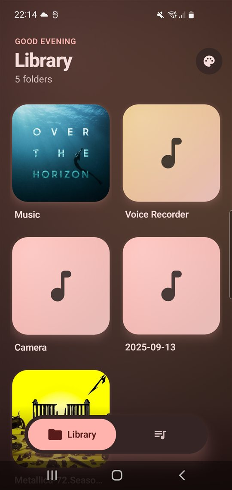
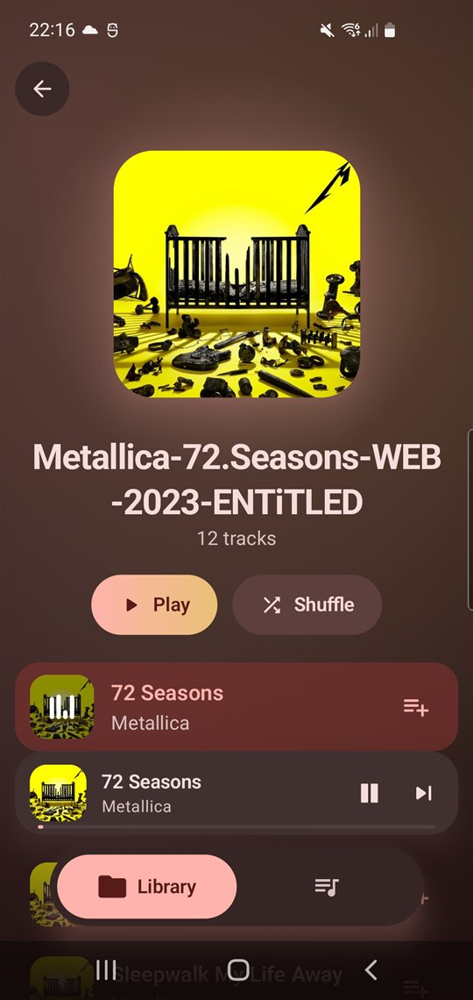
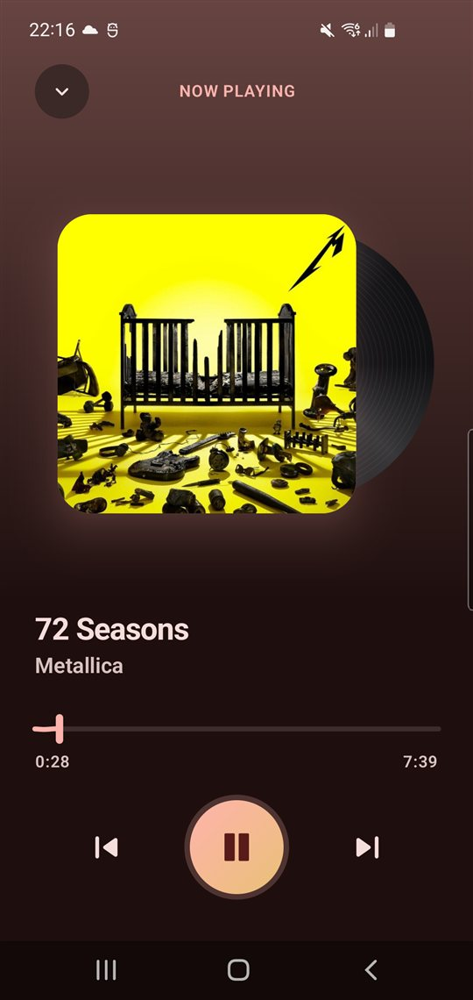
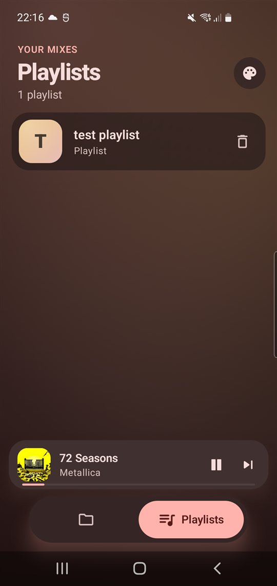
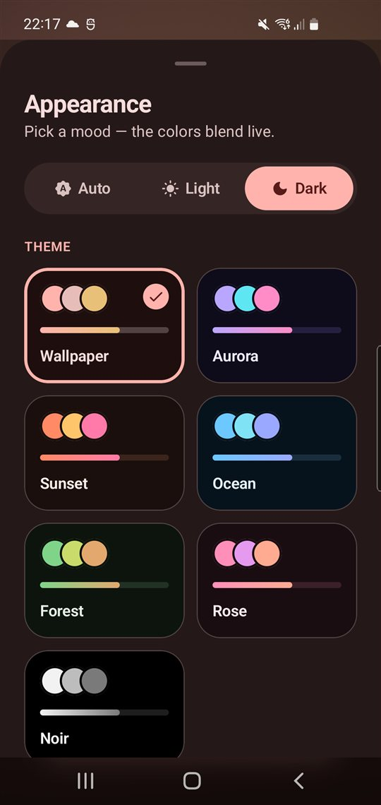
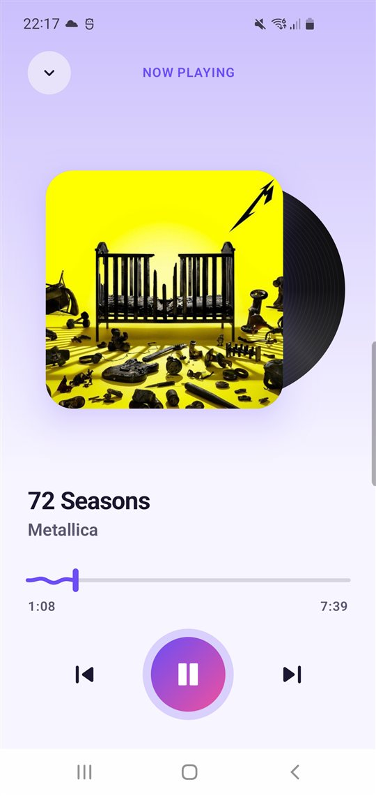
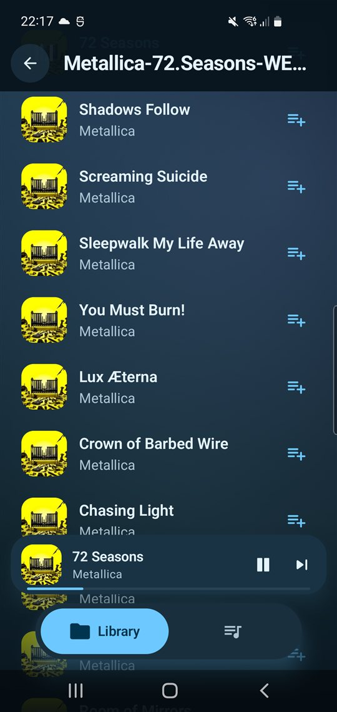
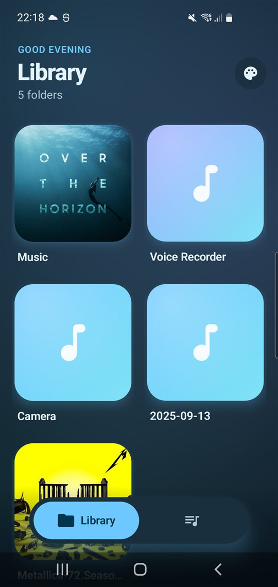

# 🎵 MusicPlayer

A modern, lightweight music player for Android that plays the music already on your phone. It's
built with Jetpack Compose and Material3, uses Media3 (ExoPlayer) for playback, and stores playlists
with SQLDelight.

Browse your music by folder, build playlists, and listen through a player that slides up from a mini
bar into a full-screen view with a spinning vinyl and a wave-shaped seek bar. Notification,
lockscreen and headset controls work too, and seven color themes are available in light or dark
mode.

➡️ [Download MusicPlayer APK](https://github.com/andreiflo94/musicplayer/raw/master/builds/app-debug.apk)

## 📸 Screenshots

|                        Library                        |                        Album                        |                     Now playing                      |                        Playlists                        |
|:-----------------------------------------------------:|:---------------------------------------------------:|:----------------------------------------------------:|:-------------------------------------------------------:|
|  |  |  |  |

|                        Themes                        |                       Aurora · light                       |                        Ocean · dark                        |                       Ocean · library                       |
|:----------------------------------------------------:|:----------------------------------------------------------:|:----------------------------------------------------------:|:-----------------------------------------------------------:|
|  |  |  |  |

## ✨ Features

📂 **Browse by folder**: scans your storage and shows each music folder as a cover-art grid.

💿 **Album view**: big cover header that fades as you scroll, Play and Shuffle buttons, and animated
equalizer bars on the track that's playing.

🎚 **Morphing player**: tap or drag the mini player to expand it into a full-screen player, and drag
it back down to collapse it. Swipe the cover sideways to skip tracks. The seek bar ripples like a
wave while music plays.

📑 **Playlists**: create a playlist and add tracks to it from any track list, then play or shuffle
it. A track can be in as many playlists as you like.

🎨 **Themes**: Wallpaper (Material You), Aurora, Sunset, Ocean, Forest, Rose and Noir, each in Auto,
Light or Dark mode, behind a slowly drifting aurora background.

🔔 **System integration**: notification controls, lockscreen controls, and headset buttons.

📱 **Phones & tablets**: phones get a floating tab bar; tablets show Library and Playlists side by
side.

## 🏗 Architecture

The project follows Clean Architecture with three layers, plus Hilt for dependency injection.

### Data

- Scans `MediaStore` for music folders, tracks and album art.
- Stores playlists with SQLDelight; schema changes ship as `.sqm` migrations.
- Saves theme settings in SharedPreferences.
- Connects to the playback service through `MediaControllerManagerImpl`.

### Domain

Holds the core models (`Track`, `ThemeSettings`, …) and the interfaces: `MediaControllerManager`
plus the repositories.

### Presentation

- Built with Jetpack Compose and Material3.
- `AppShell` stacks the tab content, the player sheet and the floating nav bar.
- Each tab has its own `NavHost`.
- A single activity-scoped `MainActivityViewModel` turns player events into UI state.

### Playback

`PlaybackService` (a Media3 `MediaSessionService`) owns ExoPlayer and the media session, so playback
keeps going in the background and shows up in the notification and on the lockscreen.

## ⚙️ Tech Stack

- Kotlin + Coroutines / Flow
- Jetpack Compose (Material3, Navigation Compose)
- Media3 (ExoPlayer, MediaSession)
- SQLDelight (playlists)
- Hilt (dependency injection)
- Glide Compose (album art)
- Accompanist Permissions

## 🛠 Building

```bash
./gradlew assembleDebug        # build the APK
./gradlew installDebug         # install on a connected device
./gradlew testDebugUnitTest    # run unit tests
```

Every push to `master` triggers a CI build, and the resulting APK is committed to
`builds/app-debug.apk`.

## 🧪 Testing

JVM unit tests use Mockito against the `MediaControllerManager` interface. They cover playback
state, track info and the interactions with the controller.
